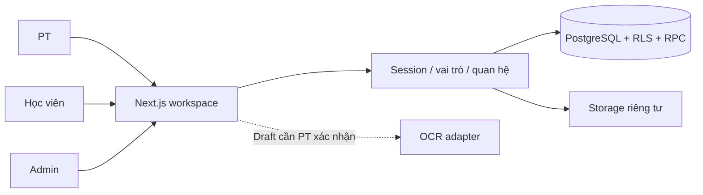

# Kiến trúc FitSync

**Checkpoint22/11/2026:** localWindows đã cài Docker/WSL2 theo chấp thuận, không reboot; production build/start và4/4demo PASS. CI0ba9821:114domain/363SQL fresh+upgrade/28core+4demo khôngretry. Cloud đọc lại22/11 vẫn27Auth/17synthetic/10candidate;0/20paid theo xác nhận owner gần nhất. [Evidence hiện hành](TEST_EVIDENCE.md). Các snapshot lịch sử bên dưới giữ nguyên thời điểm.

Đối soát 18/11/2026 trên branch `agent/fitsync-final-product`, [PR48](https://github.com/Team-SafeTrail/fitsync-app/pull/48). Đây là kiến trúc ứng viên bàn giao; không xác nhận website của Huy đã chạy phiên bản này. Không rewrite hoặc chuyển source hàng loạt.

| Thành phần | Hiện thực |
|---|---|
| Ứng dụng | npm workspaces; `apps/web`; Next.js 15.5.29, React 19.3.1, TypeScript, Tailwind 3 |
| Server | Next.js Server Components/Server Actions; không có REST backend riêng |
| Identity | Supabase Auth, session cookie qua `@supabase/ssr`, reset mật khẩu PKCE |
| Database | PostgreSQL, 14 migrations tăng dần, 20 bảng public; generated types và schema snapshot |
| Quyền | Kiểm session, vai trò PT/trainee/admin, quan hệ coaching, RLS và RPC với kiểm version |
| Storage | Bucket riêng tư InBody, ảnh bữa ăn và finance-evidence; kiểm chữ ký file, kích thước, hash khi phù hợp |
| OCR | Adapter draft, PT sửa và xác nhận trước lưu. Chưa có provider thật được benchmark; nhập tay hoạt động độc lập |
| Vận hành | CI quality; fresh database/RLS/browser; upgrade rehearsal giữ dữ liệu baseline |
| Triển khai | Huy quản lý website hiện có. Bản mới ưu tiên local; chưa đổi production |

## Luồng và các bảng

| Nhóm | Bảng public |
|---|---|
| Identity/roster | profiles, pt_profiles, trainee_profiles, trainee_invitations, trainee_profile_events |
| Số đo/engagement | inbody_records, checkins, meal_logs, ocr_attempts |
| Coaching | coaching_messages, coaching_appointments, coaching_membership_versions, coaching_notes |
| Lịch và buổi | appointment_change_requests, appointment_events, session_entitlements, session_ledger |
| Quản trị | finance_entries, billing_requests, product_events |

PT tạo hồ sơ/lời mời; học viên nhận link một lần. PT nhập số đo, xem validation và xác nhận; hai vai trò thấy cùng record theo quyền. Học viên check-in, gửi ảnh private và trao đổi với PT. Ghi chú mặc định riêng tư; chỉ ghi chú chọn shared mới đến học viên.

Membership theo ngày tách số buổi PT. Học viên đề nghị đổi/hủy lịch; lịch cũ còn hiệu lực cho đến khi PT chấp nhận. Chặn chồng lịch và cập nhật phiên bản cũ. Tạo lịch/check-in không trừ buổi. PT xác nhận cuộc hẹn đã qua và chọn có tiêu thụ buổi; ledger append-only cho phép đảo đúng một lần, không tạo buổi âm hoặc tự sửa lịch sử.

Free tối đa 3 hồ sơ chưa lưu trữ, gồm pending invite; Pro còn hạn không giới hạn học viên và cùng chức năng coaching. DB serialize tạo/khôi phục để chặn vượt cap khi chạy đồng thời. Hết hạn Pro giữ hồ sơ cũ; tạo thêm/khôi phục áp cap Free.

Admin dùng session admin và RPC tổng hợp. Sổ thu–chi append-only, mã tham chiếu/nonce chống ghi trùng; chứng từ private và SHA-256. Thuê bao thật 199.000 đ được admin đối soát mới cấp một tháng Pro. Giao dịch TEST không cấp Pro và không tính KPI. Bút toán đảo không chuyển tiền hoặc thực hiện hoàn tiền ngân hàng. Yêu cầu nâng cấp chưa phải đã trả phí.

Product events chỉ lưu tác vụ tối thiểu và nguồn tự khai báo; không gửi số đo, ảnh, chat, IP, tên hoặc URL lời mời. Synthetic bị loại khỏi số liệu kinh doanh; không suy attribution lịch sử.

## Môi trường và ranh giới

Cloud hiện có 8 bảng core, bật RLS; 12 bảng của ứng viên chưa rollout. Kiểm catalog chỉ đọc xác nhận 21 policies và hai bucket private. Không áp schema snapshot hoặc migration lên cloud trong lượt này. [Database review](../reports/DATABASE_REVIEW.html) cho owner kiểm trước khi cấp quyền giảng viên.

`npm run demo:start` chuẩn bị project Supabase local riêng `fitsync-exe201-demo`, không copy env cloud, không reset DB khác. Credential demo sinh ngẫu nhiên ngoài Git. Dữ liệu sức khỏe và thu–chi mô phỏng có nhãn. Đối soát seed và UI phải qua trước khi ghi PASS; trạng thái mới nhất ở [TEST_EVIDENCE](TEST_EVIDENCE.md).

`/app/*` là tour fixture; `/workspace/*` là dữ liệu DB có xác thực; `/admin` không dùng fixture thay sổ thật. Android không bắt buộc theo xác nhận owner. Full-report/PDF, OCR benchmark, nutrition publication và các hợp đồng pilot về retention/delete/support/abuse còn giới hạn, không được quảng bá là hoàn tất.
