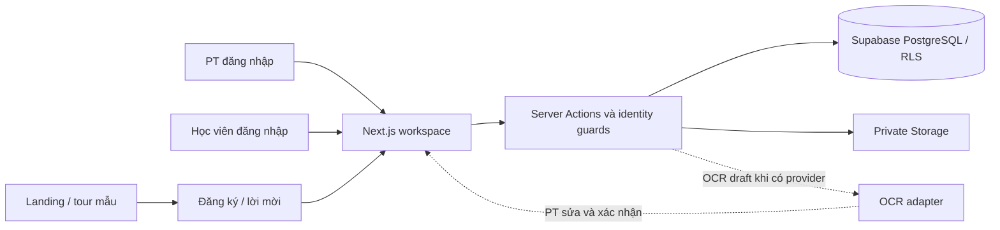

# Kiến trúc FitSync được đối soát

Snapshot source: main `3c816e9`, đọc và kiểm tra17/11/2026. Giữ kiến trúc hiện hành.

## Thành phần

| Thành phần | Hiện thực |
|---|---|
| Monorepo | npm workspaces, `apps/web`, chưa có app Android trong workspace chính |
| Frontend/backend web | Next.js14.2.21 App Router, React 18, TypeScript, Tailwind 3; Server Actions xử lý thay đổi |
| Identity | Supabase Auth, role profiles pt/trainee/admin; cookie/session qua @supabase/ssr |
| Database | PostgreSQL/Supabase, migrations tăng dần; 12 bảng public trong schema baseline main |
| Authorization | Session server + kiểm role/quan hệ + RLS/RPC. Flag rollout không thay quyền |
| Media | Storage private cho meal và InBody, xác minh MIME/signature/size, Sharp xử lý ảnh server |
| OCR | Adapter trả draft; PT phải đối chiếu/xác nhận. Default provider thật chưa cấu hình, có fake adapter cho synthetic tests |
| Coaching | Text chat, appointment create/read, membership revision và private/shared notes trong source main |
| Deployment | Vercel website; cloud Supabase riêng. GET homepage/login200, workspace307/login ngày 17/11 |
| Automation | CI web quality; Backend acceptance dùng Supabase loopback tạm, RLS và browser tests; upgrade rehearsal |

## Luồng dữ liệu

Sơ đồ mô tả kiến trúc source, không xác nhận mọi miền đã rollout cloud. Source API chủ yếu là Server Actions + Supabase Data API/RPC, không tự mô tả thành REST backend tách rời.

## Workflow cốt lõi

1. PT tạo tài khoản, tạo hồ sơ học viên và link mời một lần. Học viên nhận lời mời để liên kết identity.
2. PT nhập số đo, validation và xác nhận; hai vai trò có quyền thấy cùng record. Macro là bản nháp coaching.
3. Học viên check-in, có thể gửi meal photo private; PT xem cập nhật và cảnh báo thiếu check-in theo lịch Asia/Ho_Chi_Minh.
4. Chat/lịch/context có domain guard và migration riêng; source có UI nhưng 4 bảng tương ứng chưa truy cập được qua REST cloud17/11.
5. Membership theo ngày tách số buổi PT. Tạo lịch/check-in không tự trừ buổi; ledger completion/reversal còn là issue tương lai.

## Ranh giới bằng chứng

`/app/dashboard`, `/app/trainee` là fixture tour. `/workspace/*` cần identity và DB. `/admin` có guard nhưng phần dashboard demo không phải sổ thanh toán thật. Password reset đầy đủ ở PR 47 chưa merge; full InBody/PDF, OCR provider, Android, billing và analytics còn dependency. Không có bằng chứng iOS/CH Play release, Whisper hoặc gateway thanh toán production.

Chi tiết bảng/cột/FK đã có trong [DATABASE_V1](handoff/DATABASE_V1.md), [DATA_DICTIONARY](handoff/DATA_DICTIONARY.md), migrations và generated types. Không tạo schema thứ hai cạnh tranh với migration hiện hành.
