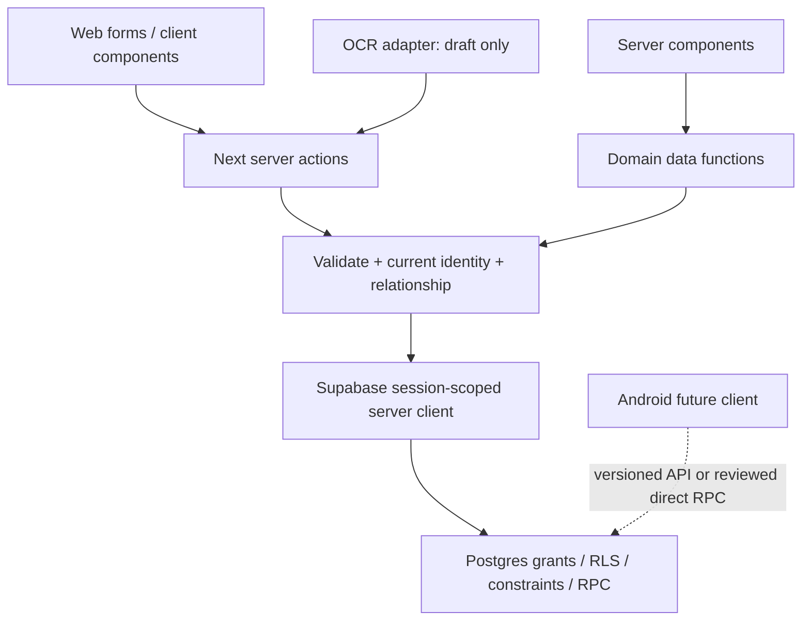

# Tìm code và nối đúng hợp đồng dữ liệu

Huy dùng bản đồ này để chọn đúng server/data boundary; Khai dùng nó để nối UI và thiết kế Android. Những hàm dưới đây là implementation web hiện hành, không phải REST API công khai hoặc hợp đồng mobile đã ổn định.

## Luồng đọc và ghi hiện hành

Không gọi Next Server Actions bằng endpoint/build ID tự suy ra từ app native. Huy/Khai phải ghi API version, error/retry semantics và auth contract cho native. RLS vẫn phải chặn direct API bên ngoài web.

## Bản đồ theo công việc

| Công việc | Code đọc/ghi | UI cần xem | Bằng chứng gần nhất |
| --- | --- | --- | --- |
| Viewer/roster/dossier/Home | `features/workspace/data.ts` | `app/workspace/`, `app/workspace/trainees/[traineeId]/` | M2/M3 + web-handoff |
| Tạo hồ sơ/nhận mời | `createTrainee`, `acceptInvitation` trong `features/workspace/actions.ts`; `features/invitations/token.ts` | `CreateTraineeForm`, `InvitationAcceptForm` | M2 + handoff |
| Nhập tay/nháp dinh dưỡng | `createInBodyRecord`, `submitInBodyForm`, `updateNutritionDraft` trong workspace actions | `InBodyForm`, `InBodyRecordCard` | M2; không phải full report |
| OCR draft/review | `features/workspace/ocr-actions.ts`, `ocr-adapter.ts`, `ocr-validation.ts` | `InBodyForm` | SQL/validation; live provider chưa nghiệm thu |
| Check-in/ảnh riêng | `submitDailyCheckin` trong workspace actions; `features/engagement/` | `CheckinForm`, `CheckinActivityList` | M3 |
| Số dư legacy | `updateRemainingSessions` trong workspace actions | `SessionBalanceForm` | M3; phải thay đường ghi khi thêm ledger |
| Chat text | `features/chat/data.ts`, `actions.ts`, `validation.ts`, `config.ts` | `ChatComposer`, `ChatHistoryViewport`, `app/workspace/chat/` | chat-private |
| Lịch | `features/scheduling/actions.ts`, `calendar.ts`, `validation.ts` | `AppointmentForm`, `CoachingScheduleSummary`, `app/workspace/calendar/` | calendar-private |
| Membership/notes | `features/coaching-context/data.ts`, `actions.ts`, `validation.ts` | `CoachingProfileContext`, `CoachingContextForms` | 33 SQL cases + web-handoff |
| Progress | `components/workspace/progress-data.ts` | `ProgressHistory`, `app/workspace/progress/` | unit + SSR regression + handoff |
| Navigation/tabs | `WorkspaceNav`, `ProfileSectionTabs` | `app/workspace/coaching.css` | keyboard/hash/draft + responsive handoff |
| Admin/sample | `features/admin/data.ts`, `app/admin/`, `app/app/` | Demo labels và aggregate counts | admin/public suites; không billing thực |

Các path trong bảng tương đối với `apps/web/src/`. Dùng `rg --files` để tìm route folder vì param tên thật có thể khác tên business. Schema/types và SQL test là nguồn chính xác về column/grant; tên hàm không chứng minh quyền.

## Ba domain mới cần bảo toàn khi nối UI

| Domain | Input và identity | Retry/conflict | Giới hạn đọc/ghi |
| --- | --- | --- | --- |
| Chat | trainee ID + text + client UUID nonce; server lấy PT/learner/sender | Cùng sender/nonce/payload trả lại thành công; đổi payload conflict | Text 1–4000, history cursor 50/page, polling; không sửa/xóa/media/read-state |
| Appointment | trainee ID, title, kind, starts/ends, nonce; PT phụ trách học viên đã liên kết | Retry đã commit vẫn nhận lại sau giờ bắt đầu; overlap `23P01`, nonce mismatch conflict | Range half-open, tối đa 24h; learner read-only; không completion/cancel/debit |
| Membership | `save_coaching_membership`: target trainee, request UUID, label, date-only starts/ends, expected revision | RPC lock hồ sơ; stale `40001`, nonce mismatch `23505`; cùng payload được nhận lại | Immutable revisions; end inclusive; không payment hoặc session debit |
| Note | trainee ID, body, visibility, nonce; PT/current pair lấy server | Nonce trùng cùng payload nhận lại; khác payload conflict | Body 1–2000, private default; pre-link chỉ private; insert-only |

`getCoachingProfileBundle` cache trong một request, lấy 10 membership revisions và 51 notes để nhận biết giới hạn hiển thị. Đây không phải infinite history API. Profile tabs giữ draft vì panes đã mount; không thay server authorization bằng cách hide tab. Nội dung PT-only không được gửi trong learner response.

## Identity không được tráo đổi

`profiles.id` là auth identity; `trainee_profiles.id` là hồ sơ nghiệp vụ; `trainee_profiles.profile_id` nullable trước nhận mời. Các bảng coaching mới lưu cả PT, learner identity và trainee ID. Không coi UUID khó đoán là authorization.

Ngày membership là date-only; appointment dùng timestamp có timezone; ứng dụng tính ngày sinh hoạt theo Việt Nam. Không biến ngày membership thành UTC midnight khiến lệch ngày. Ngày tạo record hiện không bảo đảm là ngày máy đo; full-report contract phải tách hai thứ.

## Khác biệt cần giải quyết trước Android

Repo có [issue24](https://github.com/Team-SafeTrail/fitsync-app/issues/24) ghi hướng dài hạn Expo/React Native và unified coaching timeline; [ADR003](../architecture/adr-003-android-packaging-path.md) cũ vẫn ở trạng thái Proposed, ưu tiên đánh giá TWA cho yêu cầu môn học. Bản bàn giao web không tự đảo quyết định trong issue24 hoặc chứng minh native đã có. Khai/Huy phải đối chiếu issue24 với owner và cập nhật ADR trước scaffold; không triển khai TWA rồi gọi đó là app native theo sản phẩm.

Chat hiện tại chỉ text. Structured appointment/report/meal/workout cards trong unified timeline vẫn là target, phải tham chiếu domain record có quyền đọc. Không sao chép thông tin sức khỏe vào message JSON rồi tạo hai nguồn sự thật. Calendar không bắt buộc giáo án; workout nâng cao và voice có phạm vi riêng.

## Khi thêm migration hoặc action

Viết scope/permission matrix trước; áp migration additive; giữ compatibility với web hiện hành. Thêm SQL negative/race cases và action tests cho domain đổi. Sinh types từ DB rồi nối UI/error states; chạy fresh DB và upgrade rehearsal. Ghi target contract thành implemented chỉ sau khi persistence và hai vai trò đã qua acceptance. Xem [DATABASE_V1](DATABASE_V1.md), [REMAINING_CONTRACTS](REMAINING_CONTRACTS.md) và [issue tracker](ISSUE_TRACKER.md).
