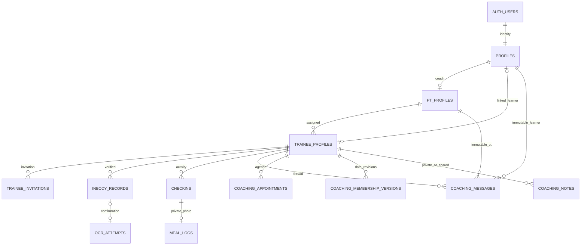

# Database v1 — implemented baseline và ranh giới

Nguồn cấu trúc: tám migration từ20260927090000 đến20261030210000. [Tệp schema-only](schema-v1.sql) được xuất từ DB test CI41092400099 (b75b9d2), không phải bản dump dữ liệu. SHA256:82E4C089C95E649A9C2538B33C85AC58D18641C612B9E661C4D4D48077185BDA. [Types hiện hành](../../apps/web/src/types/database.ts) do DB sinh; CI so khớp chính xác. Hợp đồng cho miền chưa implement ở [REMAINING_CONTRACTS](REMAINING_CONTRACTS.md).

## ERD của phần đang có

Quan hệ PT/learner trên bốn bảng coaching mới được lưu cùng trainee ID; một UUID hoặc link không đủ cấp quyền. ERD rút gọn không vẽ lại mọi FK actor/index. DDL/migrations là nguồn chính xác; generated TypeScript `Insert/Update` không mô tả privilege thực tế.

## 12 bảng public

| Bảng | Ý nghĩa / quy tắc cần giữ |
| --- | --- |
| profiles | Danh tính app, role pt/trainee/admin, tên/phone; auth.users là identity gốc |
| pt_profiles | Metadata PT và platform subscription legacy; không phải membership học viên |
| trainee_profiles | Hồ sơ riêng, assigned_pt_id, profile_id nullable trước nhận mời; balance tổng/còn lại là legacy mutable counter |
| trainee_invitations | Token hash, email chuẩn hóa, thời hạn, trạng thái, accepted identity; link dùng một lần |
| inbody_records | Bản đã xác nhận với weight/SMM/fat/PBF/water; nutrition draft vẫn nằm chung ở schema legacy, chưa phải target domain đã publish |
| ocr_attempts | Attempt/image path/provider/version/draft/status/confirmed link; server quản lý, không tự biến draft thành record |
| checkins | Một check-in/ngày Việt Nam theo luồng hiện hành; không tự tiêu buổi PT |
| meal_logs | Ảnh riêng gắn check-in hiện hành; chưa phải meal diary nhiều bữa/ngày |
| coaching_messages | Text1–4000, sender+nonce unique; immutable participant tuple; không client UPDATE/DELETE/audit time |
| coaching_appointments | Future create/read, training/consultation, time bounds≤24h, GiST overlap theo PT/learner; scheduled/retired, không completed/fee |
| coaching_membership_versions | Date-only starts_on/ends_on, inclusive end, immutable revisions; RPC kiểm expected_revision và nonce dưới lock trainee |
| coaching_notes | Body1–2000, private mặc định hoặc explicitly shared; pre-link chỉ private; insert-only và bound actor/context |

## Ma trận quyền thực thi của miền coaching mới

| Actor | Chat | Appointment | Membership | Ghi chú |
| --- | --- | --- | --- | --- |
| PT hiện hành đúng role/assignment | Đọc/gửi đúng cặp | Đọc/tạo, không direct edit/delete | Đọc/history; lưu qua RPC có version | Đọc/ghi private/shared đúng hồ sơ |
| Learner đang liên kết | Đọc/gửi cặp của mình | Đọc của mình; chưa có request/change write | Đọc current/history của cặp | Chỉ đọc shared bound đúng learner |
| PT/learner khác | Không | Không | Không | Không |
| Admin thông thường | Không override | Không override | Không override | Không override |
| Anon | Không | Không | Không | Không |
| Archive/reassign/replacement identity | Mất quyền thread cũ | Claim slot được retire; lịch cũ không chuyển chủ | Không tự kế thừa pair cũ | Không tự kế thừa notes của pair cũ |

Ghi chú private tạo trước khi nhận mời vẫn thuộc PT gốc; không tự trở thành shared sau liên kết. Membership chỉ mở khi đã có learner identity. Cờ rollout chỉ điều khiển app; gửi trực tiếp Supabase REST vẫn phải chịu grants/RLS.

## Transaction, retry và thời gian

- Chat nonce reuse chỉ thành công với cùng body/participant tuple; mất response giữ draft/nonce. Cursor giữ microseconds và UUID tie-breaker,50+1 đọc để xác định trang tiếp.
- Appointment dùng timestamptz, UI chuyển local Việt Nam+07; khoảng nửa mở `[start,end)` cho phép hai buổi liền nhau. Exclusion constraint bảo vệ insert đồng thời; guard lock quan hệ để không để slot vô hình sau archive/reassign. Retry đã commit vẫn được xác nhận sau giờ bắt đầu.
- Membership dùng date; không đi qua timezone của browser. RPC `save_coaching_membership(target_trainee,request_id,membership_label,starts_on,ends_on,expected_revision)` lock hồ sơ, xác nhận role/pair, đọc committed nonce trước kiểm version, tạo revision mới nguyên tử. Stale state40001; khác nội dung dưới nonce cũ23505.
- Membership/appointment/check-in không cập nhật remaining_sessions. Không có session ledger trong schema này; không giả lập lịch sử tiêu buổi từ hiệu total−remaining.
- Trigger/helper riêng có empty search_path, tham chiếu schema rõ và revoke EXECUTE không cần thiết. Ordinary coaching operations không dùng service-role; các thao tác upload/OCR/admin legacy cần review boundary riêng.

## Điều phải kiểm tiếp trước production

Đây là freeze baseline để nhận bàn giao, không phải chứng nhận mọi chính sách đã hoàn tất. Các bảng legacy biometrics/check-in/meal/OCR dùng lịch sử quyền/identity khác bốn bảng coaching mới. Huy phải bổ sung ca promotion role, archive/unlink/reassign và replacement learner cho legacy domains; không suy ra tests của chat chứng minh toàn bộ health data có cùng hành vi.

Retention và xóa tài khoản chưa đóng: message/member/note FKs restrict cùng parent cascades cần một quy trình rõ, không chạy DELETE rộng vì muốn “cleanup”. Chưa có rate limit vận hành, backup/restore rehearsal đầy đủ, provider benchmark hoặc billing ledger. Mỗi phần là gate riêng ở WORK_PACKAGES.

## Migration và rollback

CI có hai đường: fresh install toàn bộ migrations và upgrade từ năm migration nền với seed synthetic. Rehearsal giữ fingerprints của toàn bộ rows ở tám bảng legacy trước/sau áp additive migrations; sau đó chạy SQL/RLS và exact types diff. Kết quả thực tế nằm trong UI_ACCEPTANCE/WEB_HANDOFF_V1, không tự coi có script là đã qua.

Rollout app có thể tắt ba feature flags mà không drop bảng. Không rollback bằng cách xóa lịch sử chat, appointment, membership hoặc notes. Trước cloud rollout: xác nhận đúng môi trường, backup, review SQL/grants, diễn tập trên synthetic staging, kiểm app cũ và migration history, rồi mới có phê duyệt phát hành riêng. File schema-only phục vụ tra cứu; chạy migrations theo thứ tự trên Supabase, không import snapshot vào production để ghi đè nền đang dùng.
