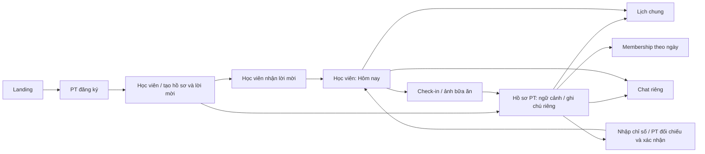

# FitSync — bàn giao web và database v1

**Dành cho Huy và Diệp Khai. Chốt ngày 31/10/2026; kiểm thử ngày 30/10/2026.** Chủ sản phẩm yêu cầu hoàn thiện web và bộ bàn giao; Android để Khai triển khai tiếp. Đây là bản ứng viên đóng băng để review kỹ thuật, chưa phải xác nhận phát hành thương mại hoặc hoàn thành toàn bộ roadmap.

## Đọc nhanh

FitSync giúp PT tiếp nhận, tra cứu và đồng hành học viên trong một không gian, giảm việc tìm lại thông tin rời rạc giữa Excel, giấy và Zalo cá nhân. PT/học viên có vai trò riêng trên web; Android là nền tảng app ưu tiên. Chủ gym nhiều PT, iOS, community/gamification và voice chưa thuộc baseline bàn giao này. Không dùng persona 5–20 hoặc định vị B2B SaaS cũ như quyết định đã được chủ sản phẩm chấp thuận.

Giá 199.000đ/tháng đã có khảo sát sơ bộ, nhưng offer/hạn mức/chi phí và vận hành thanh toán chưa hoàn tất. Thuê bao FitSync khác membership PT theo dõi cho học viên. Ngôn ngữ thiết kế đã được duyệt ở [DESIGN.md](../../DESIGN.md); không cần chọn lại brand hoặc đổi theme khi nối backend.

| Tài liệu | Dùng để làm gì |
| --- | --- |
| [Chạy dự án và kiểm thử](DEVELOPER_RUNBOOK.md) | Công cụ, local Supabase/env, commands, browser suite và troubleshooting |
| [Bản đồ code và contract](CODE_AND_CONTRACT_MAP.md) | Server actions/data/UI, identity, retry và ranh giới web/Android |
| [Nghiệm thu từng luồng](MANUAL_ACCEPTANCE.md) | Checklist thao tác PT/học viên, lỗi/quyền, responsive và biên bản review |
| [Issues đã assign](ISSUE_TRACKER.md) | Task cụ thể cho Huy/Khai, dependency, readiness và cách nhận việc |
| [Gộp nhánh và gửi Discord](MERGE_AND_SHARE.md) | Review/merge/rollout khác nhau, link bàn giao và mẫu tin nhắn |
| [Database v1](DATABASE_V1.md) | Schema hiện hành, quyền, quy tắc và giới hạn; phân biệt phần đã có với target contract |
| [Schema-only SQL](schema-v1.sql) | Snapshot cấu trúc từ DB test, không chứa rows và không phải script import production |
| [Từ điển cột sinh từ types](DATA_DICTIONARY.md) | Tên/type/nullability để web và Android không tự đặt field khác nhau |
| [Contract cho phần còn lại](REMAINING_CONTRACTS.md) | Lịch thay đổi, ledger, full report, dinh dưỡng và các cổng vận hành |
| [Checklist giao diện](UI_ACCEPTANCE.md) | Route, desktop/phone, trạng thái, bằng chứng và phần chưa kiểm |
| [Ảnh bàn giao](screenshots/README.md) | Ảnh synthetic, route/viewport và SHA256 từ acceptance run cuối |
| [Danh sách thực hiện](WORK_PACKAGES.md) | Thứ tự, dependency, người phụ trách đề xuất và điều kiện nghiệm thu |
| [Kế hoạch lượt bàn giao](../plans/WEB_HANDOFF_V1.md) | Tiến độ kiểm thử mới nhất của lượt này |
| [Quyết định chủ sản phẩm](../PRODUCT_DECISIONS.md) | Những gì phải bám; không phải PRD gốc thất lạc |

Không đọc schema target rồi tưởng migration đó đã chạy. Không dùng ảnh/fixture làm bằng chứng persistence. Không dùng tests PASS để kết luận đã chứng minh giá trị khách hàng.

Nếu nhận bàn giao qua GitHub, không cần ZIP. Sau merge, repo tại commit đã nhận là nguồn chính; ZIP cũ không tự cập nhật theo issues. Trước merge, dùng nhánh của PR31 để đọc các tệp mới. Bắt đầu với REVIEW-BASELINE (#32), không bắt đầu đồng thời mọi task đã assign.

## Luồng và điểm vào

| Route | Vai trò / chức năng |
| --- | --- |
| `/` | Giới thiệu cùng brand, đăng ký thật là CTA chính; minh họa được ghi nhãn |
| `/register`, `/login`, `/invite/[token]` | Auth PT, đăng nhập, nhận lời mời một lần; signup không tự nhận vai trò admin |
| `/workspace/today` | PT xem lịch sắp tới, học viên cần theo dõi và trạng thái kết nối |
| `/workspace` | PT: roster tìm/lọc và tiếp nhận. Học viên: Hôm nay, check-in, tiến trình, membership, ghi chú được chia sẻ |
| `/workspace/trainees/[id]` | PT phụ trách:5 tab tác vụ, progress, membership/notes, số dư buổi PT và intake |
| `/workspace/progress` | Học viên xem đầy đủ lịch sử chỉ số; Hôm nay chỉ giữ bản gần nhất để tránh trang quá dài |
| `/workspace/calendar` | Agenda tuần và form PT; học viên cùng đọc lịch, không tự ghi đè |
| `/workspace/chat`, `/workspace/chat/[id]` | Inbox/thread riêng; text, history, polling; không attachment/read receipt |
| `/app/dashboard`, `/app/trainee` | Tour công khai dùng fixtures; không phải workspace thật |
| `/privacy`, `/terms` | Thông tin trước thử nghiệm; cần review phát hành riêng |
| `/admin` | Admin hệ thống. Các bảng demo OC2 vẫn phải ghi nhãn; không phải dashboard chủ gym |

Root workspace vẫn là điểm đến sau auth để giữ luồng activation hiện hành. PT mở Hôm nay qua navigation; không đổi redirect rồi làm gãy invitation/onboarding.

## Bộ code nhận bàn giao

Branch `codex/apply-approved-coaching-design`, draft [PR31](https://github.com/Team-SafeTrail/fitsync-app/pull/31). Không tự merge, push main hoặc deploy. Huy/Khai review trên cùng checkpoint; tránh mỗi bên lấy một prototype khác nhau. Các tệp `.agents`, video và tài liệu chưa commit của chủ sản phẩm không thuộc bộ thay đổi được tự động mang sang.

Các entry point chính:

- UI: `apps/web/src/app/workspace/`, `components/workspace/`; `workspace/coaching.css` tổ chức các surface mới, `globals.css` giữ token. `DESIGN.md` là hướng visual đã duyệt.
- Data/action: `features/workspace`, `chat`, `scheduling`, `coaching-context`; identity kiểm ở server, RLS ở DB. Mobile nên dùng cùng domain contract/RPC, không sao chép UI web thành một backend riêng.
- DB: `supabase/migrations/`, `supabase/tests/`; generated `apps/web/src/types/database.ts` không được sửa tay để né schema diff.
- CI: `.github/workflows/backend-acceptance.yml`; có fresh install và rehearsal nâng cấp từ năm migration nền, dùng DB tạm loopback và dữ liệu giả.

## Chạy lại an toàn

1. Kiểm tra branch/git status, cài đúng lockfile bằng `npm ci`; không nâng dependency trong lúc nhận bàn giao. Phiên bản Next hiện hành14.2.21, Supabase CLI2.118.0.
2. Dùng Supabase local/Docker hoặc môi trường synthetic đã được phê duyệt riêng. Không mặc định project cloud lịch sử là test. CLI có sẵn qua `node node_modules/supabase/dist/supabase.js`; không cần cài CLI toàn cục.
3. Tự cấu hình `apps/web/.env.local` từ `.env.example`, giữ key ngoài Git/chat. Chỉ bật `FITSYNC_CHAT_ENABLED`, `FITSYNC_CALENDAR_ENABLED`, `FITSYNC_COACHING_CONTEXT_ENABLED` trên stack đã có migration tương ứng. Chúng là cờ rollout, không thay RLS.
4. Chạy domain tests, lint, typecheck và build. Chạy `supabase test db` qua CLI local. Browser suite dùng `FITSYNC_E2E_LOCAL_DB=true`, loopback Supabase và app cùng cấu hình; production server yêu cầu build trước. Không bypass environment guard.
5. Hai tài khoản synthetic phải đi qua invitation, record/review, check-in, chat, lịch và membership/notes. Kiểm RLS bằng SQL/direct API, không chỉ ẩn nút trên giao diện.

Các helper `ci-local-supabase.mjs` và `ci-upgrade-rehearsal.mjs` dành riêng cho runner tạm; không giả lập biến GITHUB_ACTIONS trên máy cá nhân để bỏ guard. Windows checkout hiện chưa có Docker/local DB; các authenticated checks của lượt này chạy tại CI, không phải localhost đang mở của chủ sản phẩm.

## Chốt phạm vi trước khi release

Web baseline có chức năng thật nhưng chưa gồm mọi phần của ý tưởng ban đầu. Full-report InBody/PDF/provider, yêu cầu đổi/hủy lịch, completion/ledger, target publication, nhiều bữa/ngày, media chat và Android còn có contract/ticket riêng. Không ghi những phần đó là đã implement chỉ vì đã có layout hoặc field dictionary.

Huy review schema, legacy authorization, transaction/race, lưu/xóa dữ liệu và rollout. Khai review UX, desktop/phone, keyboard/focus và Android parity. Chủ sản phẩm duyệt những quy tắc kinh doanh còn mở; human reviewer chấp nhận PR/release. Theo yêu cầu bổ sung ngày31/10, các gói việc đã được tạo thành issues và assign; xem ISSUE_TRACKER. Chưa gửi Discord hoặc thực hiện merge/deploy.

## Kết quả chốt baseline

Checkpoint code/tests `b75b9d2`:103 unit tests,202 SQL/RLS checks,23 Chromium browser tests, lint/typecheck/production build và upgrade rehearsal PASS. Run IDs và giới hạn ở [UI_ACCEPTANCE](UI_ACCEPTANCE.md). Chỉ tài liệu/ảnh bàn giao được bổ sung sau checkpoint này. Bản v1 sẵn sàng để hai người nhận review và triển khai tiếp, chưa đủ điều kiện gọi toàn bộ sản phẩm/database là production-final.
