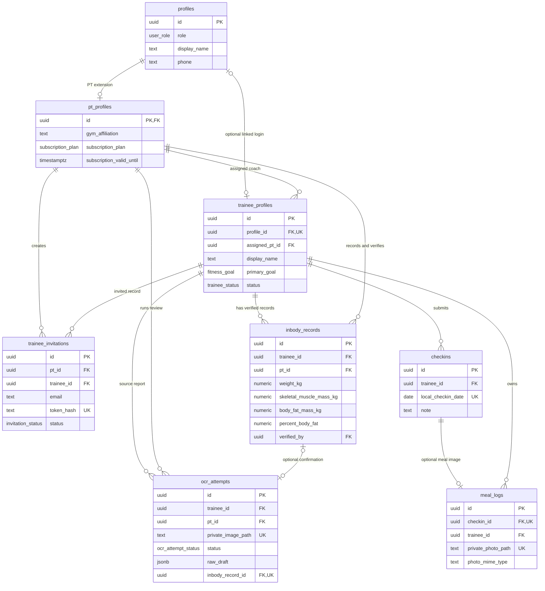

# Brief thiết kế ERD Outcome 2 gửi Toàn

## Deliverable

- Một PNG rộng tối thiểu 2560 px, đọc rõ ở zoom 100%.
- Một PDF vector hoặc có text selectable.
- Tiêu đề: `FitSync — Outcome 2 Data Architecture`.
- Footer nhỏ: `Schema source: 5 Supabase migrations — synthetic demo data only`.
- Không đưa password, token, key, connection string, signed URL hoặc dữ liệu sức khỏe thật vào hình.

## Bố cục đề xuất

- **Identity — xanh dương:** `profiles`, `pt_profiles`.
- **Coaching — cam:** `trainee_profiles`, `trainee_invitations`, `inbody_records`.
- **Engagement — xanh lá:** `checkins`, `meal_logs`.
- **OCR boundary — tím:** `ocr_attempts`.
- Đặt `auth.users` ngoài khung public schema, nối nét đứt tới `profiles` và ghi chú `Supabase Auth identity`.
- Đặt hai bucket `meal-media` và `inbody-media` ngoài khung table, dùng biểu tượng khóa và ghi `private storage`.

## Sơ đồ nguồn chính xác

Nguồn độc lập là [`FITSYNC_OC2_ERD.mmd`](FITSYNC_OC2_ERD.mmd). Cách nhanh: dán vào [Mermaid Live](https://mermaid.live/) và export SVG/PNG. Cách khuyến nghị cho bản Carbon Dark: mở [draw.io](https://app.diagrams.net/), chọn **Arrange → Insert → Mermaid → Diagram**, sau đó chỉnh màu/layout và export PNG ≥2560 px + PDF. Giữ file `.drawio` để sửa về sau.

Copy đoạn Mermaid này vào công cụ nếu không mở file `.mmd` trực tiếp:

## Callout bắt buộc

1. `RLS tenant boundary`: PT chỉ truy cập học viên được gán; học viên chỉ truy cập hồ sơ liên kết của mình.
2. `Single-use invitation`: database lưu SHA-256 hash, không lưu raw token.
3. `Private media`: object path được scope bằng `trainee_id`; ứng dụng dùng signed URL ngắn hạn.
4. `OCR is a draft`: OCR attempt không phải InBody record; chỉ PT confirmation mới liên kết tới bản ghi đã xác minh.
5. `Server boundary`: service-role key không được gửi xuống browser.
