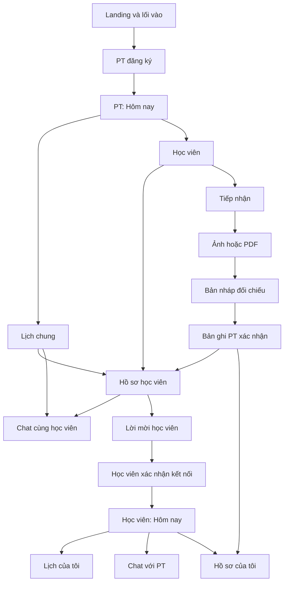

# FitSync B1-A — luồng, màn hình, quyền và dữ liệu để duyệt

Ngày: 2026-10-30. **Đề xuất UX, chưa phải thiết kế đã duyệt hoặc sản phẩm đã phát hành.**

Đầu vào: phỏng vấn chủ sản phẩm, [brief](../../PRD-FitSync.md),
[blueprint](../../plans/FITSYNC_REBUILD_BLUEPRINT.md),
[đặc tả OCR](../../plans/FITSYNC_BODY_COMPOSITION_DATA_SPEC.md) và
[review website](../../reviews/FITSYNC_WEBSITE_REVIEW_2026-10-30.md).
Mở [prototype](index.html) hoặc dùng [hướng dẫn chạy](README.md).

## 1. Công việc và kết quả cần kiểm chứng

PT chuẩn bị một buổi tập, tiếp nhận dữ liệu và tiếp tục trao đổi mà không tìm lại
ở nhiều công cụ. Học viên biết lịch nào đã chốt, xem mục tiêu/báo cáo được chia sẻ
và phản hồi trong đúng cuộc trò chuyện.

Prototype tập trung hai vòng sử dụng: lịch → hồ sơ → chat; tạo hồ sơ → nhập phiếu
→ đối chiếu → PT xác nhận → học viên được xem sau kết nối. Các số đo, tên và lịch
đều giả. Đây là mô hình tương tác trong bộ nhớ, không phải kiểm thử auth/RLS/OCR.

## 2. Hướng thiết kế tạm thời

Sau phản hồi chủ sản phẩm rằng bản đầu còn bình thường và có thể đổi màu,
bản mẫu thử hướng nền sáng, xanh teal trầm: frame `#F0F4F2`, sheet trắng,
panel `#F5F7F6`, chữ `#172D2A`, chữ phụ `#536661`, chart/action `#126F65`.
Đây là phương án đề xuất mới; chưa thay DESIGN.md hoặc theme ứng dụng thật.
Carbon/amber của lượt đầu còn trong base CSS để đối chiếu; `refresh.css` là
override đang được phục vụ, không phải hai theme để người dùng chọn.

Typography là sans dễ đọc với body 16px, tiêu đề có thứ bậc, dữ liệu dùng tabular
numerals. Bản mẫu offline dùng system fallback; chưa chốt thay font brand. Không
dùng ảnh minh họa, số KPI trang trí hoặc motion tự chạy để lấp khoảng trống.
Chart tiến triển đọc lịch sử số đo giả được đánh dấu đã xác nhận, cho phép chọn
cân nặng/tỷ lệ mỡ/cơ xương và mở bảng số liệu. Không đưa draft vào chart, không
gắn tốt/xấu tự động vào thay đổi, không có dự báo. Một lần đo không tạo đường trend.
Các giá trị và ngày lịch sử này chỉ để đánh giá UX, không phải dữ liệu khách hàng.

Desktop có sidebar và hai vùng nội dung: công việc đang làm, ngữ cảnh cần nhớ.
Phone có điều hướng dưới bốn mục, đi sâu một việc rồi quay lại. Bảng chỉ số có
scroll ngang khi thực sự cần, thay vì thu nhỏ chữ. Ghi chú cần nhớ được nhắc ngay
trong buổi sắp tới; editor nội bộ vẫn nằm sâu hơn trên phone.

Đây là prototype có độ chi tiết vừa đủ duyệt hành vi, không phải visual redesign
cuối. Landing có frame riêng và preview đổi giữa hồ sơ/lịch/báo cáo; không đặt
sidebar của app lên trang công khai. Phần lớn nội dung được trình bày thành lịch/danh sách/nhóm trường để tránh
lặp bộ card KPI của website cũ. Không ghi đè DESIGN.md.

## 3. Sơ đồ màn hình

Landing/signup và invitation thật chưa được xây trong prototype: CTA mở tình huống
giả lập, bước nhận lời mời có nút mô phỏng riêng và không sinh token quyền truy cập.

| ID | Màn hình | PT | Học viên | Hành động chính |
| --- | --- | --- | --- | --- |
| PT-01 | Hôm nay | Lịch tất cả học viên mình, việc chờ | Không | Mở buổi/hồ sơ, thêm học viên, xử lý yêu cầu |
| PT-02 | Học viên | Tìm và mở hồ sơ | Không | Tra cứu, tiếp nhận |
| SH-01 | Hồ sơ / tổng quan | Context buổi tới, note nội bộ, bản đo | Context của mình, note được chia sẻ | Mở báo cáo, gói và chat |
| SH-02 | Lịch | Các buổi mình phụ trách | Chỉ buổi của mình | Đặt/đề nghị/đổi giờ |
| SH-03 | Chat | Theo từng học viên liên kết | Với PT của mình | Gửi tin, mở thẻ buổi hẹn |
| PT-03 | Tiếp nhận | Tạo hồ sơ chưa liên kết | Không | Tên, mục tiêu, gói; email không bắt buộc |
| PT-04 | Chọn phiếu | Ảnh/PDF hoặc nhập tay | Không | Tạo draft; trong prototype chỉ chọn phiếu mẫu |
| PT-05 | Đối chiếu | Toàn thân, vùng, mở rộng | Không | Sửa, giữ nháp, xác nhận |
| SH-04 | InBody đã xác nhận | Quản lý và thêm lần đo | Xem bản được chia sẻ | Theo dõi dữ liệu và nguồn |
| SH-05 | Gói và buổi đã dùng | Xem và ghi nhận qua buổi hẹn | Xem phần của mình | Kiểm tra thời hạn, số buổi, lịch sử |
| TR-01 | Học viên hôm nay | Không | Buổi tới, mục tiêu, đường vào chat | Phản hồi, check-in tự tập |
| MK-01 | Hướng landing | Người xem mẫu | Người xem mẫu | Đánh giá nội dung và thứ tự bằng chứng |

## 4. Luồng A — lịch → hồ sơ → chat

1. PT thấy buổi 16:00 với Khánh Linh trong lịch hôm nay. Không bắt mở giáo án.
2. Tên học viên hoặc nút mở hồ sơ đưa đến context buổi tới, ghi chú gần nhất và
   bản đo gần nhất. Các chi tiết nằm dưới InBody/dinh dưỡng/gói tập.
3. PT ghi chú nội bộ; học viên không thấy nội dung này. Nhận xét chia sẻ là dữ liệu
   riêng, không tự copy note nội bộ sang chat.
4. PT mở chat, thấy thẻ của chính buổi đó. Gửi tin được hiển thị ở cả hai vai.
5. Học viên gửi đề nghị đổi giờ. Lịch và thẻ vẫn hiển thị giờ cũ cùng trạng thái chờ.
6. PT chấp nhận nếu không xung đột; giờ mới cập nhật ở lịch và chat. Từ chối/rút
   giữ giờ cũ. Đề nghị buổi mới không giữ chỗ trước khi PT chấp nhận.
7. PT xác nhận hoàn thành: một buổi được ghi sử dụng một lần, có dòng lịch sử.
   Tư vấn ban đầu và check-in tự tập không trừ gói PT.

Quy tắc đề xuất: đổi buổi đã xác nhận cần bên còn lại đồng ý; đặt buổi đã thống
nhất trực tiếp do PT ghi. Prototype cho một yêu cầu chờ toàn bộ mô hình để giới
hạn phạm vi; sản phẩm thật phải theo từng appointment, không áp giới hạn toàn hệ thống.

Bài tập tùy chọn có thể thêm tên/hiệp/lần/ghi chú ngay trong buổi. B1-A chưa tích
hợp OpenGym, chưa ghi log từng set, tạ hoặc cardio timer. Các trường đó nằm trong
thiết kế tương lai theo loại bài; không bắt PT điền để lưu một lịch hẹn.

## 5. Luồng B — tiếp nhận → nhập phiếu → đối chiếu

1. PT nhập tên giả, mục tiêu, optional phone, ngày gói và tổng buổi PT. Lưu được
   trước khi có email hoặc tài khoản học viên.
2. Phiếu ảnh/PDF mẫu tạo draft giả lập. Không có file picker/upload tài liệu thật
   hoặc OCR provider trong prototype. Phiếu đối chiếu được ghi rõ là mẫu tổng hợp,
   không mang logo/model để tránh giả hỗ trợ máy cụ thể.
3. PT xem ba nhóm: toàn thân, năm vùng, mở rộng. Sửa giá trị nhưng giữ source
   nguyên bên cạnh. Thiếu trường không được tự điền 0. Reference % có thể hơn 100.
4. “Giữ bản nháp” quay về hồ sơ PT; có đường tiếp tục. Bản nháp không xuất hiện
   phía học viên. Dữ liệu mới không thay bản đã xác nhận cho tới lần confirm.
5. PT đánh dấu đã đối chiếu rồi xác nhận. Missing/invalid field dẫn về nhóm và ô
   cần xử lý; không mất số đã sửa ở tab khác. Có một số cross-field checks mẫu;
   đây chưa phải bộ validation sản phẩm/chuẩn sinh lý.
6. Kết quả xuất hiện trong hồ sơ với trạng thái xác nhận và nguồn. Nếu học viên
   chưa kết nối, vẫn chưa thấy hồ sơ; PT có thể mô phỏng gửi và nhận lời mời sau đó.

Fallback OCR: lỗi không chặn nhập tay. Giá trị nhập tay trong prototype trống để
người review thấy chi phí thao tác; giữ phiếu mẫu làm nguồn đối chiếu. Chưa đo
accuracy, tốc độ provider hoặc hiệu quả thực tế của luồng này.

## 6. Ma trận quyền và chia sẻ đề xuất

| Dữ liệu/thao tác | PT phụ trách | Học viên đã kết nối | Không liên quan |
| --- | --- | --- | --- |
| Intake và hồ sơ chưa liên kết | Tạo/quản lý theo quyền xử lý dữ liệu | Không | Không |
| Report draft và source review | Xem/sửa/xác nhận | Không | Không |
| Bản ghi đã xác nhận, được chia sẻ | Xem | Xem của mình | Không |
| Ghi chú nội bộ | Đọc/ghi | Không | Không |
| Target/nhận xét chia sẻ | Quản lý | Xem và phản hồi | Không |
| Chat | Thành viên cuộc trò chuyện | Thành viên cuộc trò chuyện | Không |
| Lịch | Tạo/chấp nhận yêu cầu | Xem của mình/đề nghị/xác nhận | Không |
| Buổi hoàn thành và ledger | Ghi nhận/điều chỉnh có audit | Xem | Không |
| Bài giao | Tạo/quản lý | Xem, log nếu được giao | Không |

Đổi vai trên toolbar là công cụ review, không phải flow cho phép user tự đổi role.
Prototype chỉ chứng minh cách hiển thị/ẩn và chuyển trạng thái; không chứng minh
phân quyền backend. B2 phải có server checks/RLS/storage/realtime và isolation tests.
Owner gym, nhiều PT một học viên, chuyển PT và quyền lịch sử sau unlink chưa chốt.

## 7. Bảng dữ liệu cần thiết kế tiếp

| Đối tượng | Dữ liệu chính | Nguồn/ai cập nhật | Điều kiện |
| --- | --- | --- | --- |
| Trainee intake | Tên, mục tiêu, contact tùy chọn, connection status | PT; học viên chỉ cập nhật trường được cho phép | Không ép email vào bước nhận hồ sơ |
| Membership | Ngày bắt đầu/kết thúc, loại gói | PT | Date range tách buổi sử dụng |
| PT package/ledger | Total, opening balance, completion/reversal, actor/reason/time | Server từ thao tác PT | Atomic/idempotent; không sửa balance không audit |
| Appointment | PT/trainee, start/end, timezone, type, status | PT/trainee qua request | Conflict ở server, không lộ lịch người khác |
| Change request | Old/new time, proposer, response, version | Hai bên | Không xóa giờ cũ trước khi chốt |
| Message | Conversation, author, nội dung, thời gian, entity reference | Thành viên | Thẻ chat trỏ cùng appointment, không nhân bản dữ liệu |
| Private/shared note | Tác giả, nội dung, visibility và thời gian | PT | Visibility rõ; không trộn hai loại |
| Report/source | Ngày đo/nhập, vendor/model/template khi biết, file metadata, version | PT/source được phép | File riêng, không raw OCR vô thời hạn |
| Extracted draft | Values, presence status, evidence, provider/schema version | Server adapter | Chưa phải verified snapshot |
| Verified metrics | Core totals, segments và extended metrics | PT xác nhận | Snapshot/revision; không tự suy nhóm cơ |
| Target | Energy/macros, hiệu lực, người duyệt, trạng thái chia sẻ | PT | BMR máy khác calorie target |
| Exercise assignment | Item nguồn, loại, liều lượng theo bài, snapshot | PT | OpenGym/license quyết định riêng |

Report mẫu có 28 ô: 9 toàn thân, 15 theo vùng (lean/fat/reference của năm vùng),
4 mở rộng. Đây chỉ là tập trường cho prototype, không phải schema hỗ trợ mọi máy.
Trường không có trên phiếu cần trạng thái riêng với không đọc được/chưa duyệt.
Phiên bản thật dùng support matrix và [đặc tả chi tiết](../../plans/FITSYNC_BODY_COMPOSITION_DATA_SPEC.md).
Không có SQL hoặc migration trong gói này; giữ dữ liệu/UUID/validation cũ cho tới B2.

## 8. Trạng thái đã thể hiện và phần chưa mô phỏng

| Trạng thái | Cách thử |
| --- | --- |
| Hồ sơ chưa kết nối | Mở Hoàng Nam hoặc tạo học viên mới |
| Chưa có report/target/ghi chú | Mở profile Minh Khoa/Hoàng Nam và các tab |
| Không có lịch trong ngày | Chọn ngày khác trong tuần |
| Loading | Chọn PDF/ảnh mẫu, chờ dữ liệu mẫu được chuẩn bị |
| Thiếu chỉ số | Toolbar “Thiếu một chỉ số”, chọn phiếu; thử xác nhận |
| OCR không sẵn sàng | Toolbar chọn lỗi; chuyển nhập tay |
| Không nhất quán | Sửa mỡ/tỷ lệ mỡ lệch; thử xác nhận |
| Chờ đổi lịch | Học viên đề nghị; chuyển PT xử lý |
| Slot xung đột | Đề nghị khung trùng buổi có sẵn |
| Không có kết quả tìm | Tìm một tên không có trong roster |
| Hoàn thành một lần | PT ghi nhận, mở lại buổi và xem nút disabled/ledger |
| Quyền hiển thị | Chuyển sang học viên, không có note nội bộ/draft/intake |

Chưa mô phỏng toàn bộ offline/reconnect, account recovery, expiry/reissue token,
push notification, upload security, hủy/vắng có phí, lịch lặp hoặc migration. Các
phần này vẫn là yêu cầu B2 trở đi; không gọi prototype là ứng dụng Android thật.

## 9. Hướng landing tương ứng

Thông điệp concept: hồ sơ có ngữ cảnh để PT chuẩn bị và tiếp tục buổi làm việc.
Hero đi kèm một buổi cụ thể, không dùng KPI doanh thu hoặc hứa tiết kiệm giờ chưa đo.
Tiếp theo là intake→review, lịch/chat và hồ sơ; proof từ màn hình đã kiểm chứng.
CTA đăng ký PT và học viên nhận mời phải tách; tour vẫn là phụ.

Trong bản mẫu, landing ghi rõ “trải nghiệm dự kiến”; CTA mở prototype. Trước
public release phải thay bằng trạng thái capability thật, không dùng concept này
như claim app đang có chat/OCR/PDF/Android. Không dựng giá, trial, testimonial hoặc
APK giả. Chưa thay landing sản phẩm hoặc chạy skill marketing/publishing.

## 10. Những quyết định để chủ sản phẩm duyệt

1. Lịch hôm nay và việc chờ làm màn đầu cho PT; hồ sơ có context trước chi tiết.
2. Intake không bắt email và report được xác nhận trước khi kết nối tài khoản.
3. Học viên đề nghị; đổi lịch đã chốt cần bên còn lại xác nhận; chat dùng cùng entity.
4. Completed trừ buổi PT một lần; tự tập/tư vấn không trừ. Hủy/vắng cần chính sách riêng.
5. PT note nội bộ khác target/note chia sẻ; draft chỉ PT thấy.
6. Ba nhóm review đủ chi tiết, có fallback/giữ nháp; không suy từng cơ từ vùng.

Việc duyệt sáu điểm này chưa duyệt toàn bộ thẩm mỹ, SQL/schema, provider, OpenGym,
mô hình giá hay phát hành. AI bữa ăn, iOS và chủ gym giữ trạng thái như blueprint.

## 11. Skill và bước sau

Lead thực hiện: frontend-design. Impeccable audit/craft floor dùng kiểm tra sau
render; không chạy critique hai subagent hay workflow tạo visual world mới.
Supabase guidance dùng để rà bảng dữ liệu/quyền; security-review giữ prototype
không upload hoặc gọi tài khoản thật. Không nạp mọi skill, cài engine/dependency mới.

Sau review người dùng: sửa prototype trước nếu luồng chưa đúng; ghi quyết định
được duyệt, rồi mới scope issue B2 nhỏ (intake/report hoặc lịch) theo playbook.
Không tự chuyển từ approval prototype sang migration/push/deploy.
