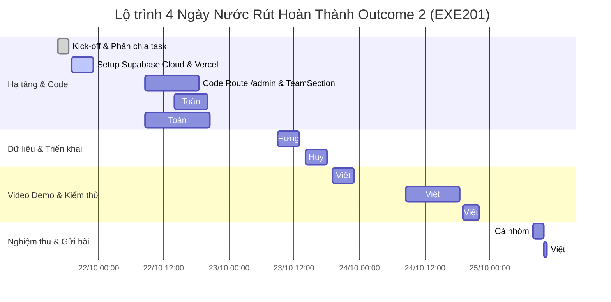
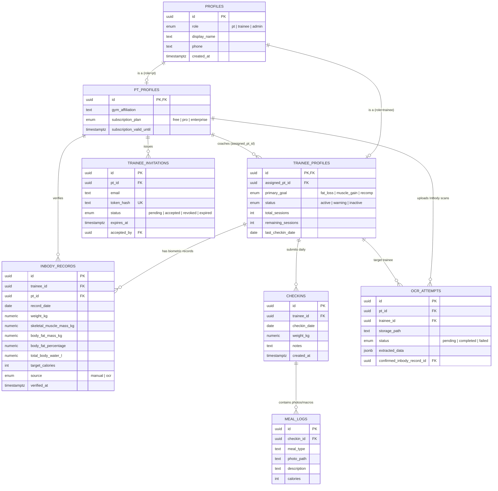

# 🚀 KẾ HOẠCH HÀNH ĐỘNG & BẢN PHÂN CHIA NHIỆM VỤ NỘP BÀI OUTCOME 2 (EXE201)
### Dự án: FitSync — B2B SaaS CRM Quản lý Huấn luyện Thể hình Cá nhân
**Nhóm thực hiện:** Team SafeTrail  
**Thời gian triển khai:** Từ Chiều Thứ Tư (21/10/2026) đến Sáng Chủ Nhật (25/10/2026)  
**Hạn chót gửi email (Hard Deadline):** **11:30 Sáng Chủ Nhật, 25/10/2026** *(Mục tiêu nộp: Trước 10:30)*  
**Người lập kế hoạch & Tổng chỉ huy:** Huỳnh Quốc Việt (Team Leader & Tech Lead)

---

## I. MỤC TIÊU CHIẾN LƯỢC & NGUYÊN TẮC TÁC CHIẾN

### 1. Mục tiêu tối thượng
1. **Zero Penalty:** Nộp bài đúng hạn 100%, gửi email trước deadline ít nhất 1 giờ (trước 10:30 Sáng Chủ Nhật).
2. **Điểm số tối đa (10/10):** Thỏa mãn trọn vẹn và vượt mong đợi cả 4 yêu cầu của Giảng viên (Landing Page, Admin Account, Database + ERD, Video Walkthrough 3–5 phút).
3. **Trải nghiệm chấm bài liền mạch (Zero Friction):** Mọi đường link (Vercel, Supabase, Google Drive, YouTube) đều truy cập được ngay lập tức trên tab ẩn danh không bị lỗi quyền hạn (Permission Denied).

### 2. Nguyên tắc phối hợp (Rules of Engagement)
- **Đúng người đúng việc & Tối ưu hóa nguồn lực:** Phân chia theo đúng tiến độ thực tế của nhóm:
  + **Lê Văn Toàn** tập trung tạo lập hệ thống 5+ tài khoản Mạng xã hội, thiết kế bộ Slide thuyết trình W4–W5 và đảm nhận thiết kế đồ họa **Sơ đồ cấu trúc dữ liệu (ERD)** dạng Infographic/PDF chất lượng cao.
  + **Huỳnh Quốc Việt** (Leader) trực tiếp đảm nhận toàn diện phần **Video Demo Product Walkthrough (3–5 phút)** từ quay màn hình, lồng tiếng, dựng clip đến upload và điều phối nộp bài.
  + **Lê Nguyễn Gia Hưng** chuyên trách khởi tạo Supabase Cloud, migrations, seed data và cấp quyền DB.
  + **Diệp Khai** code giao diện `/admin` và bổ sung `TeamSection`, CTA liên hệ trên Landing Page.
  + **Dương Quang Huy** đảm bảo hạ tầng deploy Vercel Production và kiểm thử responsive.
- **Kiểm định chéo (Cross-Review Gate):** Không tự ý đánh dấu hoàn thành nếu chưa có thành viên thứ hai kiểm thử độc lập trên tab ẩn danh và thiết bị di động.
- **Báo cáo tiến độ 2 lần/ngày:** Cập nhật trạng thái trên kênh Discord `#sprint-discuss` và di chuyển thẻ trên Trello Board vào lúc **12:00 trưa** và **21:00 tối** mỗi ngày.

---

## II. MA TRẬN PHÂN CÔNG TRÁCH NHIỆM (RACI MATRIX)

| Thành viên | Vai trò chính | Nhiệm vụ nòng cốt tại Outcome 2 | Vai trò RACI | Thẻ Trello phân công |
| :--- | :--- | :--- | :---: | :--- |
| **Huỳnh Quốc Việt**<br>(SE194225) | Team Leader & Tech Lead | - Tổng chỉ huy, giám sát tiến độ toàn đội.<br>- **Trực tiếp sản xuất trọn gói Video Demo Walkthrough (3–5 phút):** Quay màn hình các luồng, thu âm voice-over, dựng video (zoom, subtitle, nhạc nền), upload YouTube Unlisted & Drive.<br>- Soạn thảo và gửi email chính thức cho Giảng viên.<br>- Kiểm tra nghiệm thu chất lượng (Quality Gatekeeper). | **Accountable & Responsible (A/R)** | [Thẻ 5: Video Demo & Email](https://trello.com/c/HImicjro) |
| **Lê Văn Toàn**<br>(SE190816) | UI/UX Designer & Growth Lead | - **Nhiệm vụ cốt lõi W4–W5:** Thiết lập hệ thống 5+ tài khoản Mạng xã hội (TikTok, Fanpage, Instagram, Zalo OA, YouTube Shorts).<br>- **Thiết kế Slide W4–W5:** Thiết kế bộ 16-17 slide chuẩn Carbon Dark theme phục vụ thuyết trình.<br>- **Nhiệm vụ Outcome 2:** Phụ trách toàn diện phần **Sơ đồ cấu trúc dữ liệu (ERD)**: Thiết kế đồ họa ERD Infographic chuyên nghiệp, trực quan, xuất 2 định dạng: Ảnh PNG 4K và PDF; phối hợp cùng Hưng làm Data Dictionary. | **Responsible (R)** | [Thẻ 1: ERD, Slide W4-W5, MXH](https://trello.com/c/MHEJBoUs) |
| **Lê Nguyễn Gia Hưng**<br>(SE194127) | Database & Security Lead | - Khởi tạo project Supabase Cloud (Region Singapore).<br>- Đẩy toàn bộ 5 migrations và cấu hình RLS bảo mật & storage buckets.<br>- Nạp dữ liệu giả lập chất lượng cao (Seed Data) cho tài khoản Admin, PT và học viên.<br>- Cung cấp schema cấu trúc dữ liệu cho Toàn vẽ sơ đồ ERD, biên soạn bảng từ điển dữ liệu (Data Dictionary).<br>- Cấp quyền truy cập Supabase cho email Giảng viên. | **Responsible (R)** | [Thẻ 4: Supabase Cloud & DB](https://trello.com/c/VfSPFg7r) |
| **Diệp Khai**<br>(SE193097) | Frontend & Admin Lead | - Xây dựng route trang Quản trị `/admin` (System KPI, Users, VietQR).<br>- Bổ sung component `TeamSection` và Form "Liên hệ" vào Landing Page.<br>- Chèn huy hiệu/link tải ứng dụng Android APK lên Landing.<br>- Tạo và nạp dữ liệu thật (Seed Data) cho tài khoản Admin. | **Responsible (R)** | [Thẻ 2: Route /admin & Landing](https://trello.com/c/sjON7v7E) |
| **Dương Quang Huy**<br>(SE180459) | Fullstack & Cloud Ops Lead | - Triển khai mã nguồn Web App lên hạ tầng **Vercel Production**.<br>- Cấu hình biến môi trường kết nối Supabase Cloud live.<br>- Kiểm thử độ tương thích responsive trên Mobile (iOS/Android) và Desktop.<br>- Đảm bảo chứng chỉ SSL/HTTPS và đường link public sống 100%. | **Responsible (R)** | [Thẻ 3: Vercel Prod & QA](https://trello.com/c/3YIkDO9B) |

*(Ghi chú RACI: **R** = Responsible - Người trực tiếp thực hiện; **A** = Accountable - Người chịu trách nhiệm phê duyệt cuối cùng).*

---

## III. LỘ TRÌNH THỰC HIỆN THEO TỪNG NGÀY (DAY-BY-DAY ACTION PLAN)



---

### GIAI ĐOẠN 1: KHỞI ĐỘNG & THIẾT LẬP HẠ TẦNG (Tối Thứ Tư, 21/10)
- **16:30 – 18:30:** Họp nhanh Discord 30 phút, Việt phổ biến toàn bộ yêu cầu của Thầy và giao nhiệm vụ theo bảng RACI đã điều chỉnh.
- **19:00 – 23:00:**
  - **Gia Hưng:** Tạo project mới trên Supabase Cloud (tên: `fitsync-prod`), chạy toàn bộ migration từ local lên cloud, kiểm tra kết nối database.
  - **Quang Huy:** Cài đặt Vercel CLI, liên kết repo GitHub `Team-SafeTrail/fitsync-app`, chuẩn bị biến môi trường `.env.production`.
  - **Diệp Khai:** Thiết kế wireframe giao diện trang `/admin` và soạn component `TeamSection.tsx`.
  - **Lê Văn Toàn:** Bắt tay tạo lập các tài khoản Mạng xã hội (TikTok, Fanpage, Instagram, Zalo OA, YouTube Shorts) và chuẩn bị khung Slide W4–W5.
  - **Huỳnh Quốc Việt:** Chuẩn bị kịch bản chi tiết 4 phân đoạn (04:15) và thiết lập môi trường quay video demo.

---

### GIAI ĐOẠN 2: HOÀN THIỆN MÃ NGUỒN & TÀI LIỆU CƠ SỞ DỮ LIỆU (Thứ Năm, 22/10)
- **08:30 – 12:00:**
  - **Diệp Khai:** Viết mã nguồn cho route `/admin` (tạo layout, các thẻ KPI, bảng quản lý người dùng, bảng quản lý đơn hàng VietQR).
  - **Gia Hưng:** Xuất schema 8 bảng từ Supabase, gửi cấu trúc bảng và kiểu dữ liệu cho Toàn.
  - **Lê Văn Toàn:** Tiếp tục triển khai thiết kế bộ Slide W4–W5.
- **13:30 – 17:30:**
  - **Diệp Khai:** Bổ sung `TeamSection` (thông tin 5 thành viên SafeTrail) và section "Liên hệ" vào `page.tsx` của Landing Page; thêm nút tải bản Android APK.
  - **Lê Văn Toàn:** Thiết kế đồ họa **Sơ đồ cấu trúc dữ liệu (ERD)** 8 bảng dạng Infographic chuyên nghiệp, xuất file ảnh PNG 4K và định dạng PDF.
  - **Gia Hưng:** Hoàn thiện bảng chú giải Data Dictionary giải thích chi tiết ý nghĩa từng cột.
- **19:00 – 22:00:**
  - **Quang Huy & Khai:** Tạo Pull Request, chạy kiểm thử Vitest và Playwright E2E cục bộ đảm bảo không bị xung đột; Việt review và merge vào nhánh `main`.

---

### GIAI ĐOẠN 3: TRIỂN KHAI CLOUD & QUAY MÀN HÌNH SẢN PHẨM (Thứ Sáu, 23/10)
- **08:30 – 12:00:**
  - **Quang Huy:** Kích hoạt Deploy Production trên Vercel với domain `https://fitsync-safetrail.vercel.app`. Xác nhận trang Landing Page mở được công khai mà không cần đăng nhập.
  - **Gia Hưng:** Nạp dữ liệu giả lập chất lượng cao (Seed Data) lên Supabase Cloud:
    + Tạo tài khoản Admin: `admin@fitsync.vn` (Mật khẩu: `FitSync@2026Admin!`).
    + Nạp 4 tài khoản PT, 12 tài khoản học viên, 15 bản ghi InBody, 8 ảnh bữa ăn check-in, 3 giao dịch VietQR đã thanh toán.
- **13:30 – 17:30:**
  - **Gia Hưng:** Gửi lời mời chia sẻ quyền xem Supabase Cloud Dashboard đến email Giảng viên; chuẩn bị tài khoản đăng nhập Supabase dự phòng cho Thầy.
  - **Khai & Huy:** Mở trình duyệt ẩn danh (Incognito), đăng nhập tài khoản Admin, kiểm tra toàn bộ luồng xem danh sách, lọc học viên, cảnh báo đỏ, kiểm tra responsive trên điện thoại thật.
- **19:00 – 23:00:**
  - **Huỳnh Quốc Việt:** Tiến hành quay màn hình Full HD 1080p các phân đoạn sản phẩm (màn hình Landing, màn hình PT Workspace, màn hình Học viên di động, màn hình Admin Portal) theo kịch bản chuẩn.

---

### GIAI ĐOẠN 4: HẬU KỲ VIDEO DEMO & TỔNG DUYỆT ĐỘC LẬP (Thứ Bảy, 24/10)
- **08:30 – 12:00:**
  - **Huỳnh Quốc Việt:** Thu âm file lồng tiếng (Voice-over) theo kịch bản 4 phân đoạn, tiến hành ghép video quay màn hình với giọng đọc, bổ sung nhạc nền công nghệ nhẹ nhàng, hiệu ứng zoom vào các số liệu quan trọng.
  - **Lê Văn Toàn:** Hoàn tất toàn bộ Slide W4–W5 và hoàn thiện profile 5 kênh MXH.
- **13:30 – 17:30:**
  - **Huỳnh Quốc Việt:** Hoàn thiện hậu kỳ video demo, chèn phụ đề (subtitles/captions), xuất video chất lượng Full HD 1080p (đảm bảo thời lượng trong khoảng 3 phút 30 giây đến 4 phút 30 giây).
  - **Huỳnh Quốc Việt:** Upload video lên YouTube ở chế độ **Unlisted** VÀ tải một bản dự phòng lên Google Drive, bật quyền *"Anyone with the link can view"*.
- **19:00 – 22:00:**
  - **Cả 5 thành viên:** Thực hiện phiên tổng duyệt (Dry Run):
    + Mỗi thành viên mở 1 tab ẩn danh trên điện thoại và 1 tab ẩn danh trên máy tính để test toàn bộ 4 đường link.
    + Xác nhận: Link Landing truy cập bình thường; Đăng nhập Admin thành công; Link ERD tải được file ảnh/PDF của Toàn; Link Video YouTube của Việt phát trơn tru.

---

### GIAI ĐOẠN 5: GỬI EMAIL BÁO CÁO & NGHIỆM THU (Sáng Chủ Nhật, 25/10)
- **08:00 – 09:30:** Huỳnh Quốc Việt kiểm tra lại toàn bộ email template, copy các link chính thức vào email.
- **09:30 – 10:00:** Gửi bản thảo email vào nhóm Discord để 4 bạn đọc soát lỗi chính tả và kiểm tra lại danh sách CC.
- **10:00 – 10:30 (GOLDEN HOUR):** **Huỳnh Quốc Việt chính thức bấm GỬI EMAIL cho Giảng viên**, CC toàn bộ 4 thành viên.
- **10:30 – 11:30:** Chụp ảnh màn hình hộp thư đã gửi (Sent Mail) lưu vào kho lưu trữ minh chứng của dự án. Hoàn thành sớm trước deadline 1 tiếng!

---

## IV. KỊCH BẢN QUAY VIDEO DEMO SẢN PHẨM (STORYBOARD 3–5 PHÚT)
*(Trực tiếp sản xuất, lồng tiếng và dựng video: **Huỳnh Quốc Việt**)*

Thầy yêu cầu rất khắt khe về **thời lượng (3–5 phút)** và **thứ tự 4 phần**. Kịch bản dưới đây được thiết kế chuẩn xác ở mốc **04 phút 15 giây** để Việt trực tiếp quay màn hình và thu âm:

```text
┌────────────────────────────────────────────────────────────────────────────────────────┐
│               KỊCH BẢN PHÂN BỔ THỜI GIAN VIDEO DEMO FITSYNC (TỔNG: 04:15)             │
├──────────────┬──────────────────┬──────────────────────────────────────────────────────┤
│ Thời lượng   │ Phân đoạn        │ Nội dung thao tác thị giác & Lời thoại               │
├──────────────┼──────────────────┼──────────────────────────────────────────────────────┤
│ 00:00 – 00:30│ 1. Bối cảnh &    │ - Slide/Mockup: PT quản lý lộn xộn trên Zalo/Excel.  │
│ (30 giây)    │    Nỗi đau       │ - Lời thoại: "PT mất hơn 10h/tuần làm admin, trôi    │
│              │                  │   tin nhắn, gõ tay InBody, học viên bỏ tập..."       │
├──────────────┼──────────────────┼──────────────────────────────────────────────────────┤
│ 00:30 – 02:45│ 2. Luồng người   │ - Quay Landing Page ➔ Click Tạo workspace PT.         │
│ (2 phút 15s) │    dùng chính    │ - Thao tác PT tạo học viên ➔ Sinh link mời bí mật.    │
│              │    (End-to-End)  │ - Học viên mở link trên điện thoại ➔ Check-in bữa ăn.│
│              │                  │ - PT xem ảnh bữa ăn, tạo/quét chỉ số InBody.         │
│              │                  │ - Biểu đồ cơ - mỡ trực quan tự động vẽ ra.           │
│              │                  │ - Hệ thống cảnh báo đỏ 3 ngày vắng mặt ➔ Nút Zalo.   │
│              │                  │ - Thao tác quét mã VietQR động thanh toán gói 49k.   │
├──────────────┼──────────────────┼──────────────────────────────────────────────────────┤
│ 02:45 – 03:45│ 3. Màn hình      │ - Đăng nhập vào trang Admin Portal (/admin).         │
│ (1 phút 00s) │    Quản trị      │ - Xem Dashboard KPI: Tổng PT, Học viên, Doanh thu.   │
│              │    (Admin)       │ - Danh sách quản lý User & Phân quyền RLS.           │
│              │                  │ - Bảng đối soát đơn hàng VietQR & Logs hệ thống.     │
├──────────────┼──────────────────┼──────────────────────────────────────────────────────┤
│ 03:45 – 04:15│ 4. Điểm nổi bật  │ - Nổi bật: Tự động hóa InBody, bảo mật đa tầng RLS.  │
│ (30 giây)    │    & Kế hoạch    │ - Tiếp theo: Đóng gói Android lên CH Play qua Expo,  │
│              │    tương lai     │   tích hợp Whisper Voice Logs, đạt 20+ PT trả phí.   │
└──────────────┴──────────────────┴──────────────────────────────────────────────────────┘
```

### Lời thoại chi tiết từng giây (Audio Voice-Over Script):

#### Phân đoạn 1: Bối cảnh & Vấn đề (00:00 – 00:30)
> *"Kính chào Thầy và các bạn, trong ngành huấn luyện thể hình cá nhân hiện nay, các huấn luyện viên (PT) đang phải đối mặt với một vấn đề nhức nhối: Họ mất hơn 10 giờ mỗi tuần cho các tác vụ quản trị phân mảnh. Lịch tập và ảnh bữa ăn bị trôi trong tin nhắn Zalo; các chỉ số InBody phải gõ tay thủ công vào Excel; và khi học viên chán nản bỏ tập, PT hoàn toàn không có công cụ phát hiện kịp thời. Đội ngũ SafeTrail đã phát triển **FitSync** — Nền tảng B2B SaaS CRM chuyên biệt cho PT với thông điệp: Bớt việc quản lý, thêm giờ huấn luyện."*

#### Phân đoạn 2: Luồng sử dụng chính của người dùng từ đầu đến cuối (00:30 – 02:45)
> *"Đầu tiên, người dùng truy cập trang Landing Page đã được tối ưu hiển thị trên cả điện thoại và máy tính. Huấn luyện viên chỉ mất 30 giây để tạo workspace riêng của mình.*  
> *(Chuyển màn hình vào Workspace)*  
> *Tại Dashboard quản trị, PT bắt đầu tạo hồ sơ học viên mới. Ngay lập tức, hệ thống sinh ra một đường liên kết mời độc quyền có mã hóa bảo mật.  
> *(Chuyển màn hình sang giao diện điện thoại của Học viên)*  
> *Học viên nhận link, tạo tài khoản và truy cập dòng thời gian huấn luyện 1:1. Hàng ngày, học viên chỉ cần chụp ảnh đĩa thức ăn để check-in dinh dưỡng. Dữ liệu này lập tức được đồng bộ lên máy chủ Supabase và chỉ duy nhất PT phụ trách mới có quyền xem qua cơ chế Row Level Security.  
> *(Chuyển màn hình quay lại PT Workspace)*  
> *Định kỳ, PT tiến hành cập nhật chỉ số thể hình cho học viên. Với bản ghi InBody, hệ thống kiểm soát tính logic giữa cân nặng, lượng cơ và tỷ lệ mỡ. Ngay khi PT xác nhận, hệ thống tự động vẽ nên biểu đồ trực quan hóa tiến độ cơ - mỡ, giúp PT tiết kiệm 20 phút giải thích cho học viên.  
> *Đặc biệt, nếu học viên không check-in quá 3 ngày, hệ thống sẽ tự động kích hoạt Cảnh báo đỏ (Red Alert) trên màn hình PT, kèm nút bấm mở nhanh Zalo để PT nhắn tin giữ chân học viên kịp thời.  
> *Cuối cùng, FitSync tích hợp cổng thanh toán VietQR Napas247, tự động sinh mã QR động chứa đúng số tiền và nội dung chuyển khoản để học viên hoặc PT kích hoạt gói dịch vụ trong 1 giây."*

#### Phân đoạn 3: Màn hình Quản trị Admin (02:45 – 03:45)
> *"Tiếp theo, chúng em xin phép trình bày Màn hình Quản trị Admin của FitSync.*  
> *(Chuyển sang trang /admin)*  
> *Khi đăng nhập bằng tài khoản Quản trị viên hệ thống, Admin có một bức tranh toàn cảnh về toàn bộ nền tảng:  
> - Đầu tiên là Bảng điều khiển KPI: Hiển thị thời gian thực tổng số huấn luyện viên đang hoạt động, số lượng học viên, số lượng bản ghi InBody đã xác nhận và doanh thu thuê bao tạm tính.  
> - Kế tiếp là Bảng Quản trị Người dùng: Cho phép xem danh sách toàn bộ các PT và học viên, trạng thái tài khoản đang hoạt động, có đang trong diện cảnh báo hay không.  
> - Bảng Quản trị Giao dịch VietQR: Lưu trữ toàn bộ mã đơn hàng, lịch sử chuyển khoản và trạng thái kích hoạt gói dịch vụ minh bạch.  
> - Toàn bộ dữ liệu này được bảo vệ nghiêm ngặt bằng chính sách Supabase RLS, ngăn chặn tuyệt đối tình trạng rò rỉ dữ liệu giữa các phòng gym và người dùng."*

#### Phân đoạn 4: Điểm nổi bật & Kế hoạch tiếp theo (03:45 – 04:15)
> *"Điểm nổi bật nhất của FitSync nằm ở khả năng cắt giảm đến 80% thời gian giấy tờ cho huấn luyện viên, giao diện phong cách thể thao Carbon hiện đại và kiến trúc cơ sở dữ liệu y tế an toàn.  
> Trong giai đoạn tiếp theo, đội ngũ SafeTrail đang hoàn tất việc đóng gói ứng dụng Android qua Expo EAS Build để xuất bản lên Google Play Store, tích hợp công nghệ AI Whisper ghi nhật ký tư vấn bằng giọng nói và đẩy mạnh tiếp cận thực địa để đạt mục tiêu 20 khách hàng trả phí trong môn học.  
> Xin chân thành cảm ơn Thầy đã theo dõi video demo của nhóm SafeTrail!"*

---

## V. HƯỚNG DẪN KỸ THUẬT & CODE MẪU CHO NHÓM

### 1. Code Mẫu Component Thông Tin Nhóm (`TeamSection.tsx`)
*File đích: `fitsync-app/apps/web/src/components/landing/TeamSection.tsx`*

```tsx
import React from "react";
import { Users, ShieldCheck, Code, Smartphone, Database, Palette } from "lucide-react";

const teamMembers = [
  {
    name: "Huỳnh Quốc Việt",
    id: "SE194225",
    role: "Team Leader & Tech Lead",
    subRole: "Product Architecture & Quality Gate",
    email: "tyviet1609@gmail.com",
    icon: ShieldCheck,
    color: "#FF6B00",
  },
  {
    name: "Lê Văn Toàn",
    id: "SE190816",
    role: "UI/UX Designer & Growth Lead",
    subRole: "Design System & Marketing Traction",
    email: "toanlvse190816@fpt.edu.vn",
    icon: Palette,
    color: "#10B981",
  },
  {
    name: "Dương Quang Huy",
    id: "SE180459",
    role: "Fullstack & Cloud Ops",
    subRole: "Vercel Deployment & API Integration",
    email: "huydqse180459@fpt.edu.vn",
    icon: Code,
    color: "#3B82F6",
  },
  {
    name: "Lê Nguyễn Gia Hưng",
    id: "SE194127",
    role: "Database & Security Architect",
    subRole: "Supabase Migrations & RLS Policies",
    email: "hunglngse194127@fpt.edu.vn",
    icon: Database,
    color: "#A855F7",
  },
  {
    name: "Diệp Khai",
    id: "SE193097",
    role: "Frontend & Mobile Engineer",
    subRole: "Admin Console & Android Packaging",
    email: "khaidse193097@fpt.edu.vn",
    icon: Smartphone,
    color: "#F59E0B",
  },
];

export default function TeamSection() {
  return (
    <section id="team" className="fs-section fs-container" style={{ padding: "80px 24px" }}>
      <div style={{ textAlign: "center", marginBottom: "48px" }}>
        <p className="fs-eyebrow" style={{ color: "#FF6B00", fontWeight: 700, letterSpacing: "1.5px" }}>
          ĐỘI NGŨ PHÁT TRIỂN DỰ ÁN
        </p>
        <h2 style={{ fontSize: "2.2rem", fontWeight: 800, color: "#FFFFFF", marginTop: "8px" }}>
          Team SafeTrail — <span style={{ color: "#FF6B00" }}>FitSync</span>
        </h2>
        <p style={{ color: "#94A3B8", maxWidth: "600px", margin: "12px auto 0" }}>
          Sinh viên Đại học FPT TP.HCM — Khóa K18/K19 — Môn học: EXE201 (Khởi nghiệp & Phát triển Dự án Công nghệ)
        </p>
      </div>

      <div
        style={{
          display: "grid",
          gridTemplateColumns: "repeat(auto-fit, minmax(220px, 1fr))",
          gap: "24px",
        }}
      >
        {teamMembers.map((member) => {
          const Icon = member.icon;
          return (
            <div
              key={member.id}
              style={{
                backgroundColor: "#151921",
                border: "1px solid #232936",
                borderRadius: "16px",
                padding: "24px",
                textAlign: "center",
                transition: "transform 0.2s ease, border-color 0.2s ease",
              }}
            >
              <div
                style={{
                  width: "56px",
                  height: "56px",
                  borderRadius: "50%",
                  backgroundColor: "rgba(255, 107, 0, 0.1)",
                  display: "flex",
                  alignItems: "center",
                  justifyContent: "center",
                  margin: "0 auto 16px",
                  color: member.color,
                }}
              >
                <Icon size={28} />
              </div>
              <h3 style={{ fontSize: "1.1rem", fontWeight: 700, color: "#FFFFFF", marginBottom: "4px" }}>
                {member.name}
              </h3>
              <p style={{ fontSize: "0.85rem", color: "#FF6B00", fontWeight: 600, marginBottom: "8px" }}>
                MSSV: {member.id}
              </p>
              <p style={{ fontSize: "0.9rem", color: "#E2E8F0", fontWeight: 500, marginBottom: "4px" }}>
                {member.role}
              </p>
              <p style={{ fontSize: "0.78rem", color: "#64748B" }}>
                {member.subRole}
              </p>
            </div>
          );
        })}
      </div>
    </section>
  );
}
```

---

### 2. Sơ Đồ Cơ Sở Dữ Liệu ERD (Chuẩn Mermaid.js 8 Bảng)



---

## VI. TIÊU CHÍ NGHIỆM THU (DEFINITION OF DONE — DOD)

Trước khi Huỳnh Quốc Việt bấm nút gửi email lúc 10:00 sáng Chủ Nhật, toàn bộ các tiêu chí sau bắt buộc phải được đánh dấu tích xanh `[x]`:

- [ ] **1. Landing Page (Khai & Huy):** Đã truy cập được qua URL public từ mạng 4G điện thoại không cần đăng nhập; có đầy đủ 5 thành viên nhóm SafeTrail; có CTA Đăng ký & Liên hệ; có nút tải bản Android APK.
- [ ] **2. Admin Account (Khai & Hưng):** Đã đăng nhập thử nghiệm trên trình duyệt ẩn danh bằng tài khoản `admin@fitsync.vn`; xem được danh sách PT, học viên và biểu đồ doanh thu; không có lỗi phân quyền.
- [ ] **3. Database & ERD (Hưng & Toàn):** Project Supabase Cloud đang ở trạng thái active; đã mời email Thầy hoặc cung cấp tài khoản viewer; file sơ đồ ERD (PNG 4K + PDF) do **Lê Văn Toàn** thiết kế đã upload lên Drive và mở quyền view.
- [ ] **4. Video Walkthrough (Huỳnh Quốc Việt):** Thời lượng đạt từ 03:00 đến 05:00 (chuẩn 04:15); âm thanh giọng đọc rõ ràng; nội dung khớp 4 phần theo thứ tự; link YouTube Unlisted / Drive mở được ở tab ẩn danh.
- [ ] **5. Email Nghiệm Thu (Huỳnh Quốc Việt):** Tiêu đề chuẩn xác: `[EXE201] Outcome 2 - SafeTrail - [Mã lớp]`; người gửi là Huỳnh Quốc Việt; đã CC đầy đủ 4 bạn còn lại; các link kiểm tra 100% không bị chặn quyền truy cập.

---
*Tài liệu này là chỉ dẫn hành động bắt buộc cho toàn bộ 5 thành viên Team SafeTrail. Mọi thắc mắc cần trao đổi ngay trên kênh Discord `#sprint-discuss`.*
